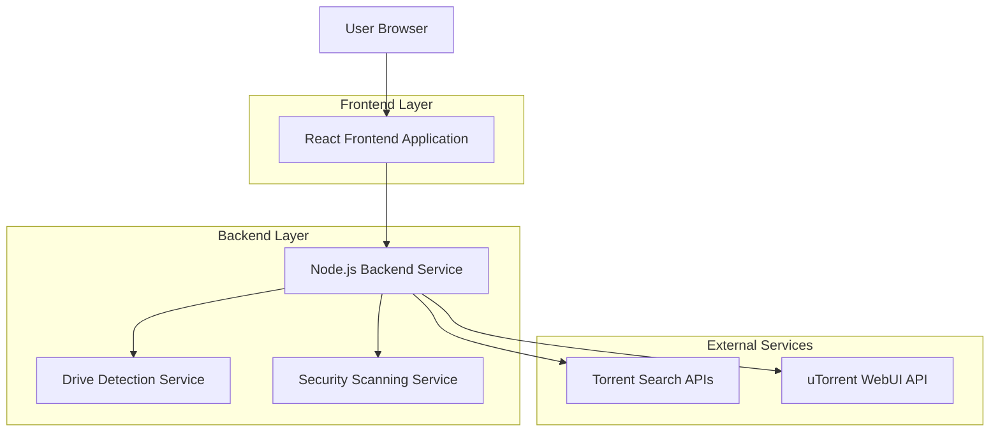
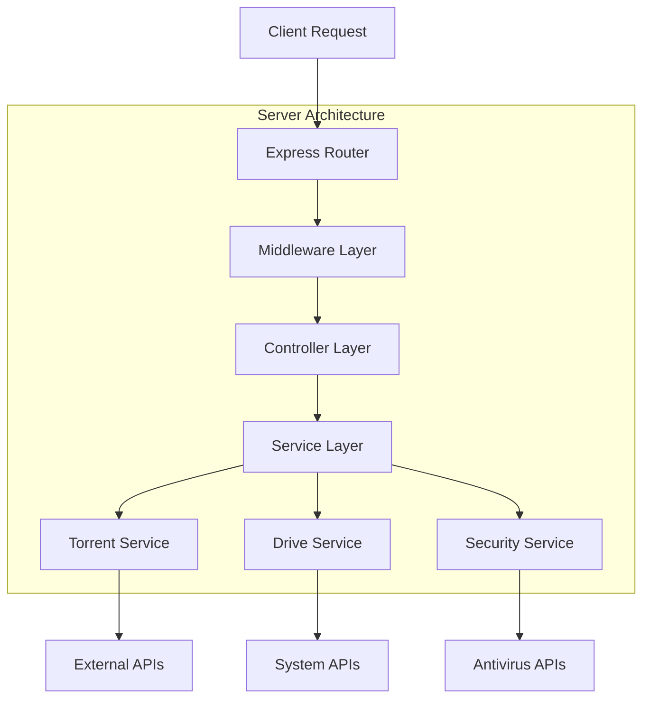
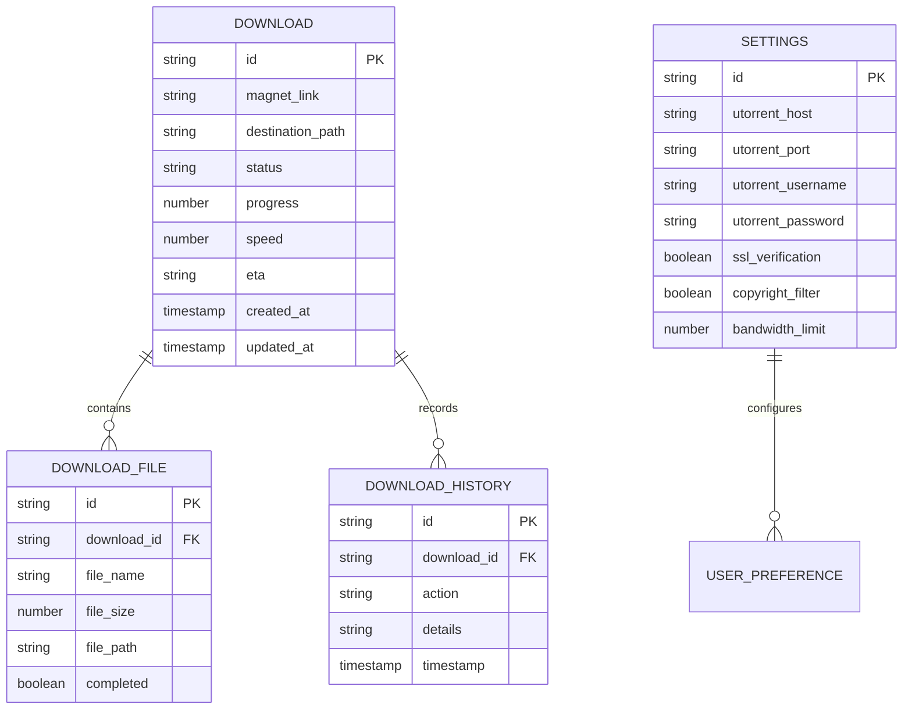

## 1. Architecture Design



## 2. Technology Description

- **Frontend**: React@18 + tailwindcss@3 + vite
- **Initialization Tool**: vite-init
- **Backend**: Node.js@20 + Express@4
- **Additional Libraries**: 
  - axios for API requests
  - socket.io for real-time updates
  - electron-builder for desktop packaging

## 3. Route Definitions

| Route | Purpose |
|-------|---------|
| / | Search interface for torrent discovery |
| /downloads | Download management and progress monitoring |
| /settings | Application configuration and uTorrent integration |
| /history | Download history and file organization |

## 4. API Definitions

### 4.1 Torrent Search API
```
GET /api/torrents/search
```

Request:
| Param Name | Param Type | isRequired | Description |
|------------|------------|------------|-------------|
| query | string | true | Search query string |
| category | string | false | Content category filter |
| minSeeders | number | false | Minimum seeder count |
| maxSize | number | false | Maximum file size in MB |
| format | string | false | File format filter |

Response:
| Param Name | Param Type | Description |
|------------|------------|-------------|
| results | array | Array of torrent objects |
| totalCount | number | Total search results |

Example Response:
```json
{
  "results": [
    {
      "name": "Example File",
      "size": 1500,
      "seeders": 1250,
      "leechers": 45,
      "format": "MP4",
      "magnetLink": "magnet:?xt=urn:btih:...",
      "hash": "abc123def456"
    }
  ],
  "totalCount": 150
}
```

### 4.2 Drive Detection API
```
GET /api/system/drives
```

Response:
| Param Name | Param Type | Description |
|------------|------------|-------------|
| drives | array | Available drive information |

Example Response:
```json
{
  "drives": [
    {
      "letter": "C:",
      "label": "System Drive",
      "totalSpace": 500000,
      "freeSpace": 150000,
      "type": "local"
    },
    {
      "letter": "D:",
      "label": "Data Drive",
      "totalSpace": 1000000,
      "freeSpace": 750000,
      "type": "local"
    }
  ]
}
```

### 4.3 Download Management API
```
POST /api/downloads/start
```

Request:
| Param Name | Param Type | isRequired | Description |
|------------|------------|------------|-------------|
| magnetLink | string | true | Magnet link or torrent URL |
| destination | string | true | Download destination path |
| bandwidthLimit | number | false | Speed limit in KB/s |

```
GET /api/downloads/progress/:id
```

Response:
| Param Name | Param Type | Description |
|------------|------------|-------------|
| progress | number | Download percentage |
| speed | number | Current download speed |
| eta | string | Estimated time remaining |
| status | string | Current download status |

## 5. Server Architecture Diagram



## 6. Data Model

### 6.1 Data Model Definition



### 6.2 Data Definition Language

Download Table (downloads)
```sql
-- create table
CREATE TABLE downloads (
    id UUID PRIMARY KEY DEFAULT gen_random_uuid(),
    magnet_link TEXT NOT NULL,
    destination_path VARCHAR(500) NOT NULL,
    status VARCHAR(50) DEFAULT 'pending' CHECK (status IN ('pending', 'downloading', 'paused', 'completed', 'failed')),
    progress DECIMAL(5,2) DEFAULT 0.00,
    speed INTEGER DEFAULT 0,
    eta VARCHAR(20),
    created_at TIMESTAMP WITH TIME ZONE DEFAULT NOW(),
    updated_at TIMESTAMP WITH TIME ZONE DEFAULT NOW()
);

-- create indexes
CREATE INDEX idx_downloads_status ON downloads(status);
CREATE INDEX idx_downloads_created_at ON downloads(created_at DESC);

-- create download files table
CREATE TABLE download_files (
    id UUID PRIMARY KEY DEFAULT gen_random_uuid(),
    download_id UUID REFERENCES downloads(id) ON DELETE CASCADE,
    file_name VARCHAR(255) NOT NULL,
    file_size BIGINT,
    file_path VARCHAR(500),
    completed BOOLEAN DEFAULT FALSE,
    created_at TIMESTAMP WITH TIME ZONE DEFAULT NOW()
);

-- create download history table
CREATE TABLE download_history (
    id UUID PRIMARY KEY DEFAULT gen_random_uuid(),
    download_id UUID REFERENCES downloads(id) ON DELETE CASCADE,
    action VARCHAR(100) NOT NULL,
    details TEXT,
    timestamp TIMESTAMP WITH TIME ZONE DEFAULT NOW()
);

-- create settings table
CREATE TABLE settings (
    id UUID PRIMARY KEY DEFAULT gen_random_uuid(),
    utorrent_host VARCHAR(255) DEFAULT 'localhost',
    utorrent_port INTEGER DEFAULT 8080,
    utorrent_username VARCHAR(100),
    utorrent_password VARCHAR(100),
    ssl_verification BOOLEAN DEFAULT TRUE,
    copyright_filter BOOLEAN DEFAULT TRUE,
    bandwidth_limit INTEGER DEFAULT 0,
    created_at TIMESTAMP WITH TIME ZONE DEFAULT NOW(),
    updated_at TIMESTAMP WITH TIME ZONE DEFAULT NOW()
);

-- insert default settings
INSERT INTO settings (utorrent_host, utorrent_port, ssl_verification, copyright_filter) 
VALUES ('localhost', 8080, TRUE, TRUE);
```