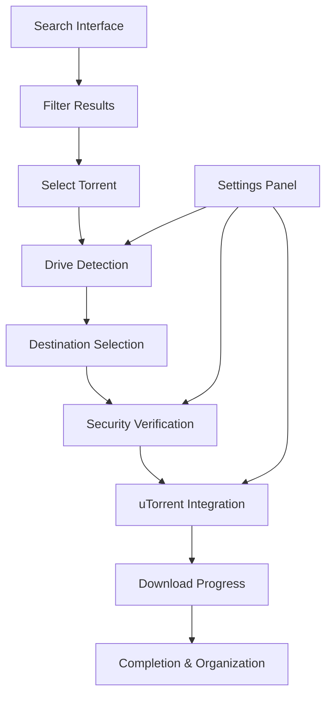

## 1. Product Overview
A comprehensive torrent search and download management tool that integrates internet-based torrent discovery with automated download functionality. The application provides a secure, user-friendly interface for searching torrents, managing downloads, and organizing files while ensuring compliance with copyright laws.

- Solves the problem of manual torrent searching and download management
- Target users: Individuals who need efficient torrent management with security and legal compliance
- Market value: Provides a safer, more organized alternative to traditional torrent clients

## 2. Core Features

### 2.1 User Roles
| Role | Registration Method | Core Permissions |
|------|---------------------|------------------|
| Standard User | Local application access | Search torrents, manage downloads, configure settings |
| Advanced User | Local application access | Additional bandwidth controls, advanced filtering, API configuration |

### 2.2 Feature Module
The torrent management tool consists of the following main pages:
1. **Search Interface**: Query input, search filters, results display with metadata
2. **Download Management**: Progress monitoring, bandwidth controls, queue management
3. **Settings Panel**: Drive configuration, security settings, uTorrent integration setup

### 2.3 Page Details
| Page Name | Module Name | Feature description |
|-----------|-------------|---------------------|
| Search Interface | Search Input | Accept user queries with real-time suggestions and auto-complete |
| Search Interface | Filter Controls | Apply filters for file size, seeders, format, copyright exclusion |
| Search Interface | Results Display | Show torrent results with metadata (size, seeders, leechers, format) |
| Search Interface | Result Selection | Allow users to review and select torrents for download |
| Download Management | Drive Detection | Automatically detect available local and external storage devices |
| Download Management | Destination Selection | Present only active/plugged-in drives for user selection |
| Download Management | Progress Monitoring | Display real-time download progress, speed, and ETA |
| Download Management | Bandwidth Controls | Adjust upload/download limits and pause/resume functionality |
| Download Management | Queue Management | Organize and prioritize multiple downloads |
| Settings Panel | uTorrent Integration | Configure WebUI API connection and authentication |
| Settings Panel | Security Configuration | Set up SSL verification and malware scanning integration |
| Settings Panel | Copyright Filters | Configure content filtering rules and safe search parameters |
| Settings Panel | Error Handling | Configure network timeout and retry settings |

## 3. Core Process
**Standard User Flow:**
1. User opens application and enters search query
2. System searches torrent sources and displays filtered results
3. User reviews torrent metadata and selects desired content
4. System detects available drives and prompts for destination selection
5. User confirms download location and security settings
6. System integrates with uTorrent to initiate download
7. User monitors progress and manages bandwidth through interface

**Download Flow:**
1. Search query submission → Results filtering → User selection
2. Drive detection → Destination selection → Security verification
3. uTorrent API integration → Download initiation → Progress monitoring
4. Completion notification → File organization → Post-download management

## 4. User Interface Design

### 4.1 Design Style
- **Primary Colors**: Dark blue (#1a1a2e) for header, light gray (#f5f5f5) for background
- **Secondary Colors**: Green (#4CAF50) for success states, red (#f44336) for errors
- **Button Style**: Rounded corners with subtle shadows, hover effects for interactivity
- **Font**: Modern sans-serif (Inter or Roboto), 14px for body text, 16px for headers
- **Layout Style**: Card-based design with clear separation of search, results, and management sections
- **Icons**: Material Design icons for consistency and clarity

### 4.2 Page Design Overview
| Page Name | Module Name | UI Elements |
|-----------|-------------|-------------|
| Search Interface | Search Input | Large input field with search icon, auto-complete dropdown, recent searches |
| Search Interface | Results Grid | Card-based layout showing torrent name, size, seeders/leechers, format badges |
| Search Interface | Filter Sidebar | Collapsible panel with size range slider, format checkboxes, seeder minimum |
| Download Management | Progress Cards | Horizontal progress bars, speed indicators, ETA timers, pause/resume buttons |
| Download Management | Drive Selector | Dropdown with drive icons, available space indicators, external device detection |
| Settings Panel | Configuration Tabs | Tabbed interface for uTorrent, security, and filtering settings |

### 4.3 Responsiveness
- **Desktop-first design** with mobile adaptation
- **Minimum width**: 1024px for optimal experience
- **Touch optimization** for tablet users with larger touch targets
- **Responsive grid** that adjusts from 3-column to 1-column layout on smaller screens

### 4.4 Security & Legal Compliance
- **SSL Verification**: Visual indicators for secure connections
- **Copyright Warnings**: Clear alerts for potentially infringing content
- **Safe Search Toggle**: Prominent switch for enabling copyright filters
- **Confirmation Dialogs**: Multi-step confirmation for risky downloads
- **Scanning Integration**: Progress indicators for malware scanning